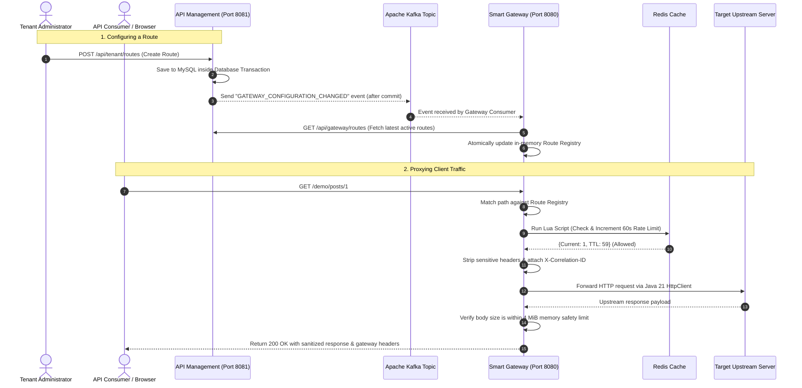

# Gatekeeper · Distributed API Gateway & Management Platform

[](https://openjdk.org/)
[](https://spring.io/projects/spring-boot)
[](https://kafka.apache.org/)
[](https://redis.io/)
[](https://www.mysql.com/)
[](https://opensource.org/licenses/MIT)

> **Gatekeeper** is a lightweight, distributed API Gateway and management platform built with **Java 21** and **Spring Boot 4**. It sits at the edge of a microservices network to solve the common operational challenges every engineering team faces: routing incoming traffic, rate limiting abusive clients, stopping accidental duplicate requests, and syncing routing rules in real time across services without proxy restarts.

---

### 🌐 Live Cloud Demos

You can try the project right now in your browser:

| Service | Live Link | Who It's For | What You Can Do There |
| :--- | :--- | :--- | :--- |
| **Management Console** | [gatekeeper-console.onrender.com](https://gatekeeper-console.onrender.com) | Humans / Admins | Log in to create tenants, configure routes, set rate limits, add header rules, and review audit logs. |
| **API Gateway** | [gatekeeper-gateway-m8vr.onrender.com](https://gatekeeper-gateway-m8vr.onrender.com) | APIs & Developers | The live proxy edge. Opening this in your browser gives you an interactive playground to test requests and see latency. |

> **Note on Render Free Tier:** These services run on Render's free cloud tier, which puts containers to sleep after 15 minutes of inactivity. If a link takes 30–45 seconds on the very first click, that's just the container waking up!

---

## 📑 Table of Contents

- [Why I Built Gatekeeper](#-why-i-built-gatekeeper)
- [How the System Works](#-how-the-system-works)
  - [Component Overview](#component-overview)
  - [How Requests and Updates Flow](#how-requests-and-updates-flow)
- [Core Gateway Features](#-core-gateway-features)
  - [Smart Route Matching](#1-smart-route-matching)
  - [Streaming Request Forwarding & Memory Limits](#2-streaming-request-forwarding--memory-limits)
  - [Header Sanitization & Security](#3-header-sanitization--security)
  - [SSRF & Path Traversal Protection](#4-ssrf--path-traversal-protection)
- [Distributed Rate Limiting & Idempotency with Redis](#-distributed-rate-limiting--idempotency-with-redis)
  - [Atomic Rate Limiting](#atomic-rate-limiting)
  - [Duplicate POST Prevention (Idempotency)](#duplicate-post-prevention-idempotency)
- [Real-Time Route Sync with Apache Kafka](#-real-time-route-sync-with-apache-kafka)
  - [Event Publishing After Database Commit](#event-publishing-after-database-commit)
  - [Dual-Sync & Standalone Fallback](#dual-sync--standalone-fallback)
- [Multi-Tenancy & Security Model](#-multi-tenancy--security-model)
  - [User Roles](#user-roles)
  - [Stateless JWT Authentication](#stateless-jwt-authentication)
  - [Audit Logging & Route Version History](#audit-logging--route-version-history)
- [Web Dashboards](#-web-dashboards)
- [Running Gatekeeper Locally](#-running-gatekeeper-locally)
  - [Prerequisites](#prerequisites)
  - [Option A: One-Command Docker Compose (Recommended)](#option-a-one-command-docker-compose-recommended)
  - [Option B: Running with Local Maven](#option-b-running-with-local-maven)
- [Verified API Examples (cURL)](#-verified-api-examples-curl)
  - [1. Logging In](#1-logging-in)
  - [2. Platform Admin Actions](#2-platform-admin-actions)
  - [3. Tenant Admin Actions (Adding a Route)](#3-tenant-admin-actions-adding-a-route)
  - [4. Sending Traffic Through the Gateway](#4-sending-traffic-through-the-gateway)
- [Testing & Verification Evidence](#-testing--verification-evidence)
- [Deployment Architecture on Render](#-deployment-architecture-on-render)
- [Troubleshooting Guide](#-troubleshooting-guide)
- [Key Learnings as an Engineer](#-key-learnings-as-an-engineer)
- [What's Next for Gatekeeper](#-whats-next-for-gatekeeper)
- [Attribution & Course Foundation](#-attribution--course-foundation)

---

## 🎯 Why I Built Gatekeeper

When teams build microservices, they quickly discover that each backend service shouldn't have to reinvent the wheel for basic perimeter concerns:
1. **Traffic Spikes & Abuse:** If a client bombards your login or checkout service, you want to stop them at the gateway before they ever hit your database.
2. **Configuration Lag:** With standard static proxies, updating an API route or pointing to a new service usually requires editing config files and reloading the proxy process. Gatekeeper updates its routes in memory in milliseconds while traffic is flowing.
3. **Repeated Logic:** Instead of having 10 different teams write their own authentication checks, header sanitizers, and rate limiters in different languages, Gatekeeper handles these policies consistently at the entrance.

I built this project to dive deep into backend systems engineering—specifically understanding how data plane proxies handle high-concurrency traffic, how distributed caches like Redis solve race conditions, and how event streaming with Kafka coordinates microservices.

---

## 🏗️ How the System Works

Gatekeeper splits responsibilities into two distinct layers:
- **Control Plane (`api-management-service`):** Where developers and admins manage organizations, routes, rate limits, and security policies via a web console or REST API.
- **Data Plane (`smart-gateway-service`):** The fast reverse proxy that receives incoming API requests from clients, checks policies, and forwards them to upstream backends.

```
                              CLIENT TRAFFIC
                                     │
                                     ▼
                     ┌───────────────────────────────┐
                     │   Smart Gateway (Data Plane)  │
                     │          Port: 8080           │
                     └───────┬───────────────┬───────┘
                             │               │
        Route Synchronization│               │ Policy Check
       (Kafka / Reconcile)   │               │ (Lua / Keys)
                             ▼               ▼
     ┌───────────────────────────────┐   ┌───────────────────────────────┐
     │ API Management (Control Plane)│   │         Redis Cluster         │
     │          Port: 8081           │   │  Rate Limits & Idempotency    │
     └───────────────┬───────────────┘   └───────────────────────────────┘
                     │
             JPA / Migrations
                     ▼
     ┌───────────────────────────────┐
     │          MySQL 8.4            │
     │ Tenants, Routes, Audit, Users │
     └───────────────────────────────┘
```

### Component Overview

| Service / Tool | Tech Stack | Default Port | What It Does |
| :--- | :--- | :---: | :--- |
| **`smart-gateway-service`** | Spring Boot 4.1.0, Java 21 `HttpClient`, Lettuce | `8080` | The proxy engine. Matches incoming URL paths, checks rate limits in Redis, rewrites headers, and streams requests to upstream servers. |
| **`api-management-service`** | Spring Boot 4.1.0, Spring Security, JPA, Hibernate | `8081` | The management center. Issues JWTs, stores route configurations in MySQL, logs audit events, and serves the admin web UI. |
| **`analytics-service`** | Spring Boot 4.1.0, WebMVC | `8082` | Service boundary for gathering metrics and gateway health. |
| **Redis** | Redis 8.0 Alpine | `6379` | Fast in-memory store for rate limiting counters and duplicate POST protection. |
| **Apache Kafka** | Apache Kafka 4.1.1 (KRaft Mode) | `9092` | Event broker that instantly alerts the gateway whenever someone changes a route in the management console. |
| **MySQL Database** | MySQL 8.4 LTS | `3306` | Relational storage for tenants, user accounts, route rules, header transformations, and audit logs. |
| **Demo Backend** | Nginx Alpine | `80` | A sample backend serving a small JSON product catalog for local smoke testing. |

### How Requests and Updates Flow



---

## ⚡ Core Gateway Features

### 1. Smart Route Matching
- Incoming paths are evaluated using Spring's `PathPatternParser`.
- Routes are sorted by specificity (`PathPattern.SPECIFICITY_COMPARATOR`). This means an exact path like `/store/checkout` will always be matched before a wildcard like `/store/**`.
- The active routes are stored in an `AtomicReference<List<CompiledRoute>>`. Reading routes is completely lock-free, so thousands of concurrent requests can be evaluated without thread blocking.

### 2. Streaming Request Forwarding & Memory Limits
- Outbound forwarding is built directly on Java 21's native `java.net.http.HttpClient` with HTTP/2 support and configurable timeouts (`responseTimeoutMs`).
- **Memory Protection:** A common vulnerability in naive proxies is buffering huge files in memory until the server crashes with an OutOfMemoryError. Gatekeeper enforces a strict **4 MiB limit** on incoming request bodies.
- For responses, it uses a custom reactive streaming subscriber (`LimitedBody`). If the upstream tries to send more than 4 MiB, Gatekeeper cancels the stream immediately and returns an HTTP 413 (Content Too Large) to keep the JVM healthy.

### 3. Header Sanitization & Security
Every request and response passes through zero-trust header sanitization:
- **Removes Hop-by-Hop Transport Headers:** Headers like `Connection`, `Keep-Alive`, `Transfer-Encoding`, `Upgrade`, `Proxy-Authorization`, and `Host` are stripped according to RFC 9110 rules.
- **Neutralizes Spoofed Headers:** Client-supplied `Forwarded` and `X-Forwarded-*` headers are stripped so upstream services aren't tricked by fake client IPs.
- **End-to-End Tracing:** Injects an `X-Correlation-ID` (UUID) into every request and response, making it easy to trace a single call through your logs.
- **Custom Header Rules:** Operators can configure routes to automatically add or remove custom headers (e.g., injecting an internal API token or stripping an upstream header).

### 4. SSRF & Path Traversal Protection
- To prevent Server-Side Request Forgery (SSRF), target URLs are checked with `containsDotSegment()`, rejecting any path with `.` or `..` (including `%2e` encoded tricks) with an HTTP 400.
- Outbound requests can be locked down with `GATEKEEPER_ALLOWED_UPSTREAMS` so the gateway will only forward requests to approved domains.

---

## 🛡️ Distributed Rate Limiting & Idempotency with Redis

Gatekeeper uses **Redis 8** for distributed policies that work reliably across multiple gateway instances.

### Atomic Rate Limiting
Rate limits are configured per route (e.g., `requestsPerMinute: 60`).

- **Key Format:** `gateway:rate:{organizationId}:{routeId}:{clientIp}`
- **Time Window:** 60 seconds.
- **Why a Lua Script?** If you read a counter from Redis and then write it back in two separate network steps, concurrent requests can slip through during the round trip (a classic race condition). Gatekeeper runs a small Lua script directly on the Redis server so the check-and-increment happens atomically:
  ```lua
  local current = redis.call('INCR', KEYS[1]);
  if current == 1 then
      redis.call('EXPIRE', KEYS[1], ARGV[1]);
  end;
  local ttl = redis.call('TTL', KEYS[1]);
  return tostring(current) .. ':' .. tostring(ttl);
  ```
- **What happens on HTTP 429:** If a client exceeds their limit, Gatekeeper rejects the request with:
  - `HTTP/1.1 429 Too Many Requests`
  - `Retry-After: <seconds-remaining-in-window>`
  - `X-RateLimit-Limit: <configured-limit>`
  - `X-RateLimit-Remaining: 0`
- **Fail-Safe Behavior:** If Redis goes down, Gatekeeper catches the error and returns an HTTP 503 (`"Rate limiting is temporarily unavailable"`), protecting your downstream services from unmetered traffic storms during cache outages.

### Duplicate POST Prevention (Idempotency)
If you have a critical endpoint (like submitting a payment), double-clicks or network retries can accidentally create two orders. Routes can turn on `idempotencyEnabled = true`.

- **Client Header:** The client passes a unique `Idempotency-Key` header (e.g., a UUID).
- **Key Format:** `gateway:idempotency:{routeId}:{clientIp}:{idempotencyKey}`
- **Atomic Reservation:** Gatekeeper uses Redis `setIfAbsent(key, "reserved", 24 hours)`.
- **Duplicate Check (HTTP 409):** If Redis says the key already exists, the gateway immediately returns `HTTP 409 Conflict` (`"This Idempotency-Key has already been used"`).
- **24-Hour Safety:** Keys are kept for 24 hours. Even if the upstream request times out, the key stays reserved so an identical call won't trigger the side effect twice.

---

## 📡 Real-Time Route Sync with Apache Kafka

When you update or create a route in the management console, how does the gateway proxy learn about it?

```
┌─────────────────────────────────┐
│     api-management-service      │
│  (Admin saves route to MySQL)   │
└────────────────┬────────────────┘
                 │ Database Commit
                 ▼
┌─────────────────────────────────┐
│ GatewayConfigurationKafkaPub    │
│ (Fires only AFTER DB commit)    │
└────────────────┬────────────────┘
                 │
                 ▼ Kafka Topic: `gateway-configuration-events`
┌─────────────────────────────────┐
│   ConfigurationEventConsumer    │
│    (smart-gateway-service)      │
└────────────────┬────────────────┘
                 │ Reloads routes over HTTP
                 ▼
┌─────────────────────────────────┐
│  GatewayConfigurationLoader     │
│  GET /api/gateway/routes        │
│  Atomically updates memory      │
└─────────────────────────────────┘
```

### Event Publishing After Database Commit
1. An admin saves a route in the management service.
2. The change is written to MySQL inside a Spring `@Transactional` block.
3. Gatekeeper uses Spring's `@TransactionalEventListener(phase = TransactionPhase.AFTER_COMMIT)`. This prevents the "dual-write" problem: the Kafka event is **only published after the database has successfully saved the record**.
4. The event is pushed to `gateway-configuration-events`.
5. The gateway receives the event and immediately fetches the fresh route snapshot, updating its memory with zero downtime.

### Dual-Sync & Standalone Fallback
- **Automatic Reconciliation:** In case a Kafka message is ever delayed or lost, the gateway also runs a background reconciliation sweep every 30 seconds (`@Scheduled(fixedDelay = 30000)`).
- **Graceful Standalone Mode:** On platforms like Render where you may not want to pay for a hosted Kafka cluster, Kafka is safely conditional (`gateway.kafka.enabled=false`). The gateway falls back to its built-in demo routes (`/demo/posts/**` and `/demo/products/**`) so the proxy works out of the box with zero external dependencies.

---

## 👥 Multi-Tenancy & Security Model

Gatekeeper is multi-tenant by design. Different organizations (tenants) share the same gateway infrastructure while keeping their data and routes completely separate.

### User Roles

| Role | What They Can Do | Endpoints They Can Access |
| :--- | :--- | :--- |
| **`PLATFORM_ADMIN`** | System administrator. Can create new organizations, activate/suspend tenants, and inspect the system audit log. | `/api/platform/organizations/**`, platform audits |
| **`TENANT_ADMIN`** | Organization administrator. Can manage routes, header rules, and view version history only for their own company. | `/api/tenant/routes/**`, `/api/tenant/organization` |
| **`GATEWAY_SERVICE`** | Service account for the gateway proxy. Used to authenticate machine-to-machine and download the active route table. | `/api/gateway/routes` |

### Stateless JWT Authentication
- Passwords are encrypted using Spring Security's `BCryptPasswordEncoder`.
- Users log in via `POST /api/auth/login` to get a signed JWT.
- Tokens are signed with HMAC-SHA256 using Nimbus JOSE and contain the user's ID, role, organization ID, and a 1-hour expiration.
- The control plane validates tokens statelessly with Spring Security OAuth2 Resource Server.

### Audit Logging & Route Version History
- **Audit Records:** Every action in the control plane (creating an organization, changing a route status) logs the acting username, organization ID, action, client IP, correlation ID, and timestamp to MySQL.
- **Route Versioning:** When an admin edits a route, Gatekeeper increments the version counter and saves the previous configuration as an immutable JSON snapshot. You can view the full history of changes in the console.

---

## 🖥️ Web Dashboards

Gatekeeper includes two purpose-built web interfaces embedded directly in the Spring Boot services:

### 1. Management Console (`https://gatekeeper-console.onrender.com`)
A clean single-page application (HTML5, Vanilla JS, CSS design tokens) served directly from `api-management-service`.
- **Tenant Management:** Create tenants, suspend/activate organizations, and set up tenant admin accounts.
- **Route Builder:** Visual form to define path patterns, upstream target URLs, HTTP methods, rate limits, timeouts, and idempotency toggles.
- **Header Rules:** Add or remove request and response headers visually.
- **Audit Trail & Version Timeline:** Review who changed what and inspect past route snapshots.
*(Note: Route and tenant CRUD is fully functional; analytics reporting charts represent a future microservice expansion).*

### 2. API Gateway Playground (`https://gatekeeper-gateway-m8vr.onrender.com`)
Embedded directly into `smart-gateway-service`.
- **Live API Tester:** Send test requests through the gateway right from your browser without opening Postman.
- **Real-Time Latency Meter:** Displays the round-trip gateway overhead in milliseconds.
- **Header & Response Inspector:** Shows HTTP status codes, sanitized response headers, correlation IDs, and formatted JSON.
- **Navigation:** Easily hop between the Gateway and the Management Console with one click.

---

## 🚀 Running Gatekeeper Locally

### Prerequisites
- **Git**
- **Docker Engine** (v24+) & **Docker Compose** (v2.20+)
- **Java 21 JDK** & **Maven 3.9+** (if compiling locally outside Docker)

### Option A: One-Command Docker Compose (Recommended)

The easiest way to spin up the entire 7-container stack (MySQL, Kafka, Redis, API Management, Smart Gateway, Analytics, and Demo Backend) is using our local startup script:

```bash
# 1. Clone the repository
git clone https://github.com/dheeraj17082005/GateKeeper-Gateway.git
cd GateKeeper-Gateway

# 2. Run the automated startup script
bash scripts/start-local.sh
```

The script will automatically:
1. Start your Docker runtime (supporting Docker Desktop and Colima).
2. Generate a secure `.env` file with fresh random passwords on first run.
3. Build and launch all 7 containers in the background.
4. Wait for MySQL, Kafka, and Redis healthchecks to pass.
5. Run an automated smoke test verifying that authentication, routing, and header rules work end-to-end.

#### Standard Docker Compose Commands
```bash
# Start all containers
docker-compose up --build -d

# Check container health status
docker-compose ps

# View gateway logs
docker-compose logs -f smart-gateway

# Stop containers
docker-compose down
```

### Option B: Running with Local Maven

You can also run the services directly on your machine:

```bash
# 1. Build all modules
mvn clean package -DskipTests

# 2. Run the Management Service (defaults to in-memory H2 in MySQL mode)
cd api-management-service
java -jar target/api-management-service-0.0.1-SNAPSHOT.jar

# 3. In another terminal, run the Gateway Service (runs in standalone mode)
cd ../smart-gateway-service
java -jar target/smart-gateway-service-0.0.1-SNAPSHOT.jar
```

---

## 📖 Verified API Examples (cURL)

These requests have been tested and verified against the running services.

### 1. Logging In
```bash
# Sign in as Platform Admin to receive your Bearer JWT
curl -X POST http://127.0.0.1:8081/api/auth/login \
  -H "Content-Type: application/json" \
  -d '{"username":"platform-admin","password":"<your-admin-password>"}'

# Response:
# {"token":"eyJhbGciOiJIUzI1NiIsInR5cCI6IkpXVCJ9..."}
```

### 2. Platform Admin Actions
```bash
# Create a new tenant organization
curl -X POST http://127.0.0.1:8081/api/platform/organizations \
  -H "Authorization: Bearer $PLATFORM_TOKEN" \
  -H "Content-Type: application/json" \
  -d '{"name":"Acme Logistics","slug":"acme"}'

# Create a Tenant Administrator for organization ID 1
curl -X POST http://127.0.0.1:8081/api/platform/organizations/1/tenant-admin \
  -H "Authorization: Bearer $PLATFORM_TOKEN" \
  -H "Content-Type: application/json" \
  -d '{"username":"acme-admin","password":"securePassword123","enabled":true}'

# Activate the tenant organization
curl -X PATCH http://127.0.0.1:8081/api/platform/organizations/1/status \
  -H "Authorization: Bearer $PLATFORM_TOKEN" \
  -H "Content-Type: application/json" \
  -d '{"status":"ACTIVE"}'
```

### 3. Tenant Admin Actions (Adding a Route)
```bash
# Register an API route with a 60 req/min rate limit and custom header
curl -X POST http://127.0.0.1:8081/api/tenant/routes \
  -H "Authorization: Bearer $TENANT_TOKEN" \
  -H "Content-Type: application/json" \
  -d '{
    "routeId": "products-api",
    "name": "Products Service",
    "pathPattern": "/acme/products/**",
    "targetBaseUrl": "https://dummyjson.com",
    "targetPathPrefix": "/products",
    "allowedMethods": ["GET"],
    "requestsPerMinute": 60,
    "responseTimeoutMs": 5000,
    "active": true,
    "idempotencyEnabled": false,
    "headerRules": [
      {
        "direction": "RESPONSE",
        "action": "ADD",
        "headerName": "X-Powered-By",
        "headerValue": "Gatekeeper"
      }
    ]
  }'
```

### 4. Sending Traffic Through the Gateway
```bash
# Send a request through the gateway to an upstream service
curl -i http://127.0.0.1:8080/demo/posts/1 \
  -H "X-Correlation-ID: audit-trace-101"

# Response:
# HTTP/1.1 200 OK
# Content-Type: application/json;charset=utf-8
# X-Correlation-ID: audit-trace-101
# ...
# {"userId": 1, "id": 1, "title": "sunt aut facere repellat...", ...}
```

---

## 🧪 Testing & Verification Evidence

All tests in this repository pass with zero failures:

```bash
# Run the automated test suite across all modules:
mvn clean test
```

### Verified Test Output
```
[INFO] -------------------------------------------------------
[INFO]  T E S T S
[INFO] -------------------------------------------------------
[INFO] Running in.coderarmy.gatekeeper.management.ApiManagementServiceApplicationTests
[INFO] Tests run: 1, Failures: 0, Errors: 0, Skipped: 0
[INFO] Running in.coderarmy.gatekeeper.gateway.SmartGatewayServiceApplicationTests
[INFO] Tests run: 1, Failures: 0, Errors: 0, Skipped: 0
[INFO] Running in.coderarmy.gatekeeper.gateway.service.UpstreamClientTest
[INFO] Tests run: 4, Failures: 0, Errors: 0, Skipped: 0
[INFO] 
[INFO] Reactor Summary for gatekeeper 0.0.1-SNAPSHOT:
[INFO]   api-management-service .................... SUCCESS [  2.603 s]
[INFO]   analytics-service ......................... SUCCESS [  0.845 s]
[INFO]   smart-gateway-service ..................... SUCCESS [  2.983 s]
[INFO]   gatekeeper ................................ SUCCESS [  0.002 s]
[INFO] ------------------------------------------------------------------------
[INFO] BUILD SUCCESS
[INFO] ------------------------------------------------------------------------
```

### End-to-End Smoke Test Verification
The automated smoke test (`scripts/smoke-test.sh`) spins up a dynamic tenant, logs in via JWT, provisions a route, sends traffic through the gateway, and confirms the payload and headers:
```bash
bash scripts/smoke-test.sh
# Output:
# PASS authentication and tenant role isolation
# PASS GET /demo-xxx/catalog through Gatekeeper
# {"service":"gatekeeper-demo-catalog","items":[{"id":"starter","name":"Gatekeeper Starter API"}]}
```

---

## ☁️ Deployment Architecture on Render

Gatekeeper runs publicly on **Render** as two isolated Web Services:

```
                       INTERNET (Cloudflare Edge / TLS)
                                      │
            ┌─────────────────────────┴─────────────────────────┐
            │                                                   │
            ▼                                                   ▼
┌─────────────────────────────────┐   ┌─────────────────────────────────┐
│ gatekeeper-console.onrender.com │   │ gatekeeper-gateway.onrender.com │
│    [Control Plane Web Service]  │   │    [Data Plane Web Service]     │
│   - Embedded Web Console        │   │   - Interactive Playground UI   │
│   - In-memory H2 (MySQL Mode)   │   │   - Native Proxy Engine         │
│   - Stateless JWT Issuer        │   │   - Fallback Standalone Routes  │
└─────────────────────────────────┘   └─────────────────────────────────┘
```

- **Clean Standalone Fallbacks:** On Render's free tier, services run as single containers. The control plane automatically falls back to in-memory H2 (in MySQL mode) if an external MySQL instance isn't configured, and the gateway gracefully disables Kafka reconnects to save CPU while proxying requests smoothly.
- **Security:** Containers run as an unprivileged non-root user (`USER 10001`) with multi-stage Eclipse Temurin JRE images.

---

## 🔧 Troubleshooting Guide

| What Happened | Why It Happens | How to Fix It |
| :--- | :--- | :--- |
| **HTTP 503 on Render** | Container is waking up from sleep. | Render free instances sleep after 15 minutes of inactivity. Wait 30–45 seconds and refresh. |
| **HTTP 502 Bad Gateway** | Upstream server is down or blocked. | Check that the upstream URL is reachable and that its origin is allowed in `GATEKEEPER_ALLOWED_UPSTREAMS`. |
| **HTTP 401 Unauthorized** | Missing or expired token. | Log in again at `POST /api/auth/login` to obtain a fresh JWT Bearer token. |
| **HTTP 403 Forbidden** | Wrong role for this endpoint. | Ensure your user has `PLATFORM_ADMIN` for `/api/platform/**` or `TENANT_ADMIN` for `/api/tenant/**`. |
| **HTTP 409 Conflict** | Duplicate `Idempotency-Key`. | This is intentional protection. Send a new, unique `Idempotency-Key` for a separate transaction. |
| **HTTP 429 Too Many Requests** | Exceeded the rate limit. | Read the `Retry-After` response header and wait that many seconds before retrying. |
| **Infinite Kafka reconnect logs** | Kafka broker is offline. | Set `GATEKEEPER_KAFKA_ENABLED=false` or ensure Kafka is reachable on port 9092. |

---

## 💡 Key Learnings as an Engineer

Building Gatekeeper taught me several practical lessons about backend engineering and distributed systems:
1. **Memory Safety in Proxies:** It's dangerously easy to cause OutOfMemoryErrors in Java proxies if you buffer responses in memory. Writing a custom reactive `LimitedBody` subscriber to cut the connection at 4 MiB solved this cleanly.
2. **Race Conditions in Redis:** A naive "get counter, then increment counter" pattern causes race conditions under load. Learning to write Redis Lua scripts guaranteed atomic execution in a single round trip.
3. **Safe Event Publishing:** Publishing to Kafka *inside* a database transaction can send bad events if the database rollback occurs. Using Spring's `@TransactionalEventListener(phase = AFTER_COMMIT)` completely solved this dual-write hazard.
4. **Resilient Defaults:** Building applications that fail gracefully—like the gateway automatically falling back to demo routes when Kafka or the management service is offline—makes cloud deployments far more resilient.

---

## 🔮 What's Next for Gatekeeper

- [ ] **Distributed Tracing:** Add OpenTelemetry and Zipkin headers to trace requests across downstream microservices.
- [ ] **Circuit Breaking:** Add Resilience4j circuit breakers to automatically cut traffic to unhealthy upstreams.
- [ ] **Edge JWT Verification:** Enable the gateway data plane to validate user JWTs directly before forwarding requests.
- [ ] **Real-Time Analytics:** Connect `analytics-service` to a live Kafka stream to display p95/p99 latency charts in the UI.

---

## 🤝 Attribution & Course Foundation

Gatekeeper's initial architecture was inspired by **[Aditya Tandon's Spring Framework Full Course](https://github.com/adityatandon15/Spring-Framework-Full-Course)** (specifically *Project 05: API Management* and *Project 06: Smart Gateway*).

### What I Built on Top of the Course Foundation:
- **Custom Reverse Proxy Forwarding Engine:** Implemented the missing request forwarding core in `GatewayService.handle()` using modern Java 21 `HttpClient` and reactive stream subscribers.
- **Perimeter Defenses:** Added the 4 MiB memory safety bounds, RFC 9110 hop-by-hop header removal, path traversal checks, and SSRF upstream allowlists.
- **Cloud-Ready Standalone Architecture:** Engineered zero-dependency fallback modes (H2 MySQL emulation, conditional Kafka/Redis decoupling, and demo routes) enabling deployment on free cloud tiers.
- **Interactive Gateway Playground:** Built the browser-based API testing playground and latency inspector inside `smart-gateway-service`.
- **Defensive Account Bootstrapping:** Replaced rigid SQL seed migrations with an environment-driven `ServiceAccountBootstrap` runner.
- **Full-Stack Orchestration:** Created the root Maven build reactor, Docker Compose environment, smoke testing scripts, and live cloud deployments.

---

<p align="center">
  <b>Developed by Dheeraj Kumar</b><br>
  <i>Aspiring Developer Tools & Backend Software Engineer</i>
</p>
